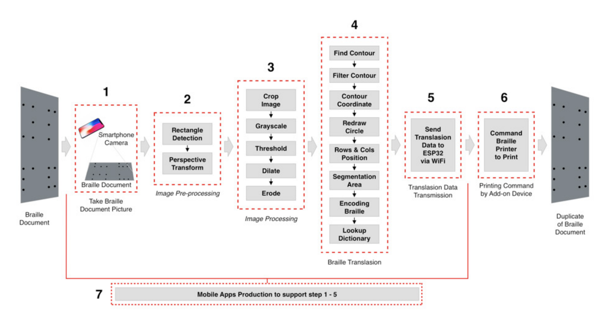

On my Final Project (Thesis) for my Bachelor degree, I made an apps that translate Braille Document, and send the translation result to the Braille Printer owned by Institut Teknologi Sepuluh Nopember (ITS) via an IoT Device to be duplicated.

The purpose of this project is to make copier system for Braille Documents. It start from the story of there are a huge numbers of Braille Documents in the libraries which are getting obselete. To conserve them, we have to re-print them. But unfortunately, they don’t have their original text, so re-printing them is imposible to do otherwise we have to translate them manually, input the translation data into computer, and print it. Imagine doing it manually to a huge numbers of Braille Documents.

Photo-Copier machine just can not do this stuff. It can only duplicate ink-printed document. But, duplicating braille document? Yes, this project will do.

  <iframe src="https://www.youtube-nocookie.com/embed/uzVC4SG5RDM" title="Braille Copying System demo video" loading="lazy" allow="accelerometer; autoplay; clipboard-write; encrypted-media; gyroscope; picture-in-picture; web-share" referrerpolicy="strict-origin-when-cross-origin" allowfullscreen></iframe>

See also my LinkedIn post for the discussion here. https://www.linkedin.com/feed/update/urn:li:activity:6811276772794093568/

In the begining of video, you’ll see the step by step how the braille document is translated to the text. It covers about cropping image, applying perspective transform, grayscaling, applying adaptive threshold, dilation, erotion, finding contour, filtering the contour, getting braille dot’s coordinate, finding the one-line dots member statistically, grouping to make a segmentation, decoding every segment, and looking up from the table to encode it to be readable text.

Then in the end part of video, you'll see how the translation data was transmitted wirelessly via HTTP Request which had been hosted by ESP32. Then, this device will communicate with braille printer via RS-232 communication protocol to print desired braille text.

Check out the publication here. https://www.sciencedirect.com/science/article/pii/S1877050921023607
