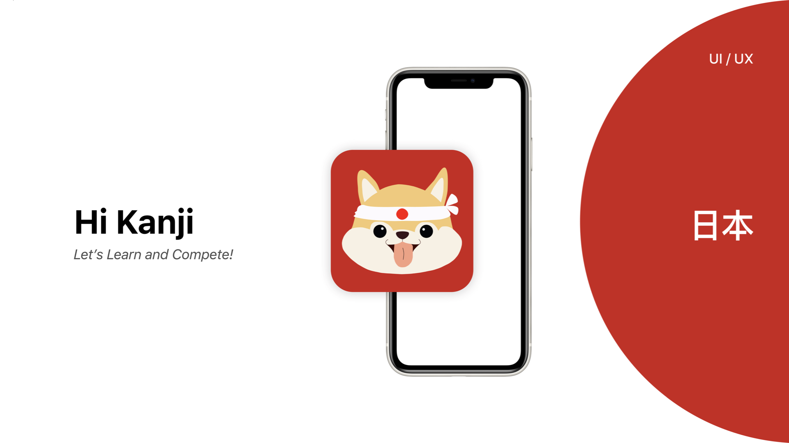
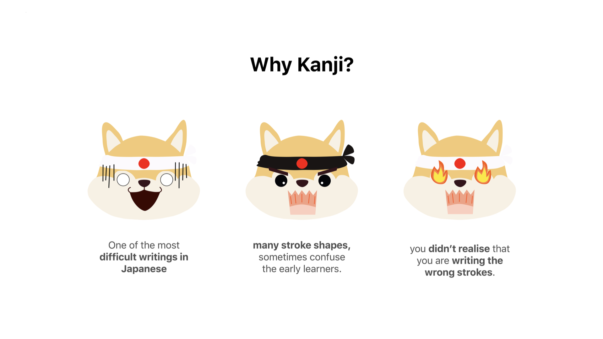
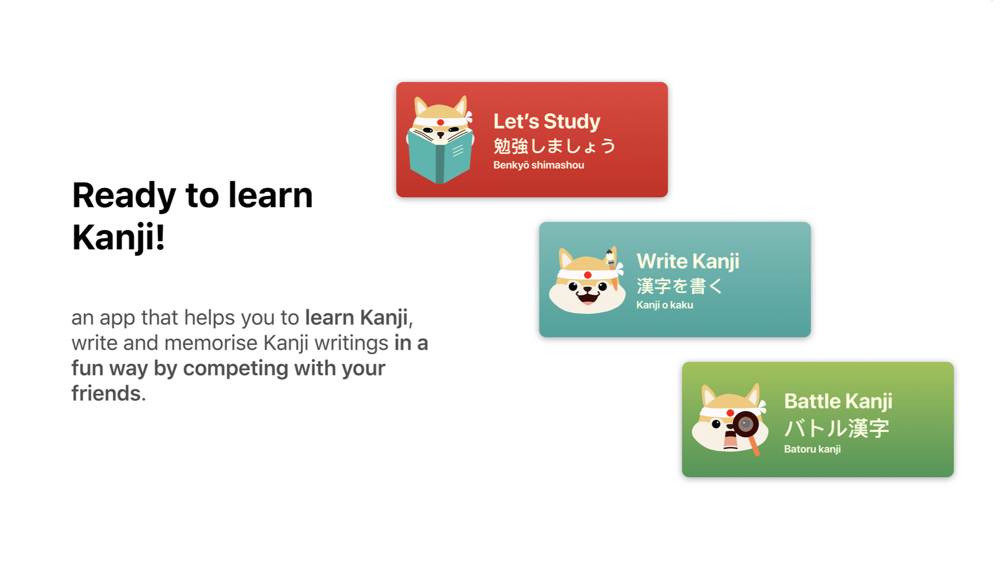
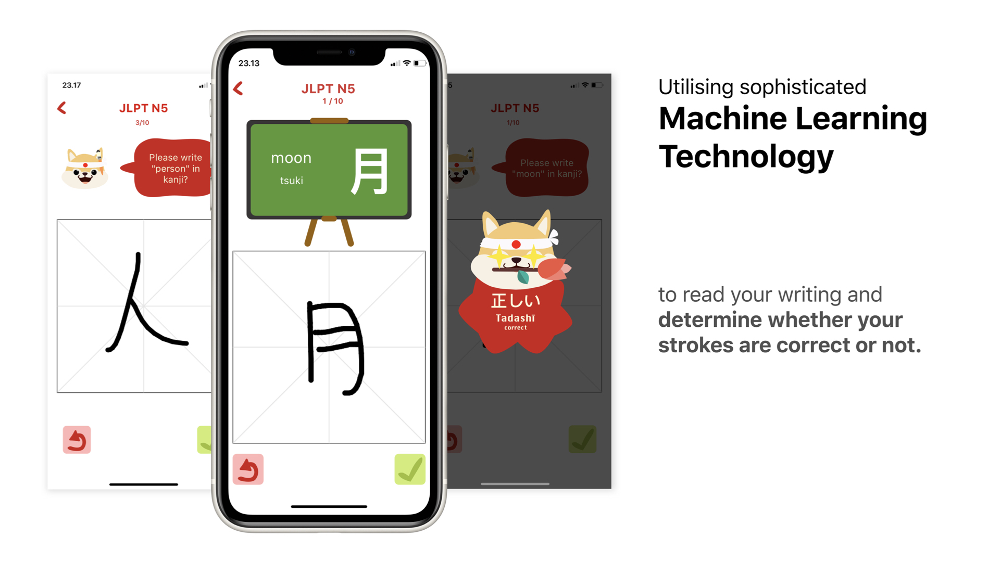
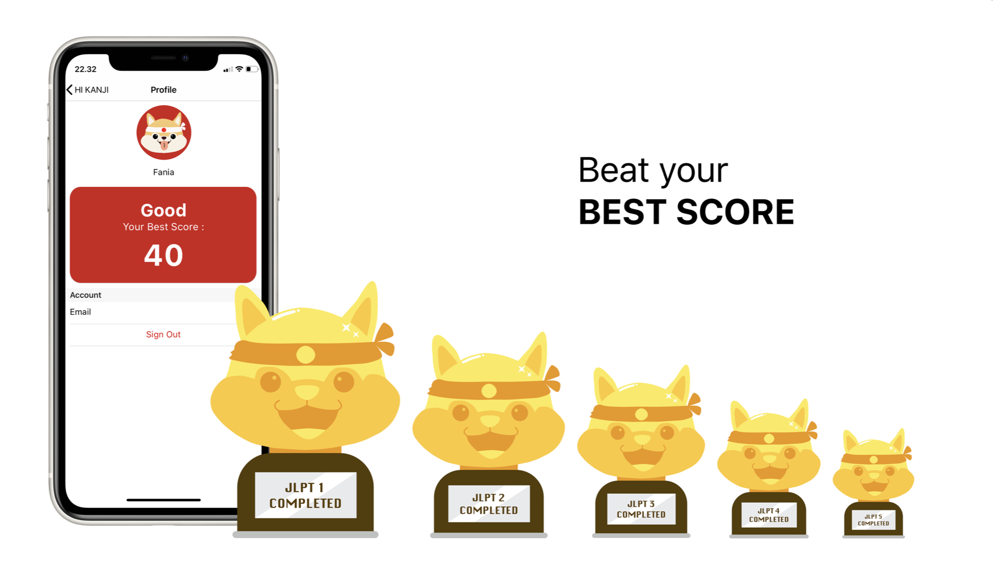
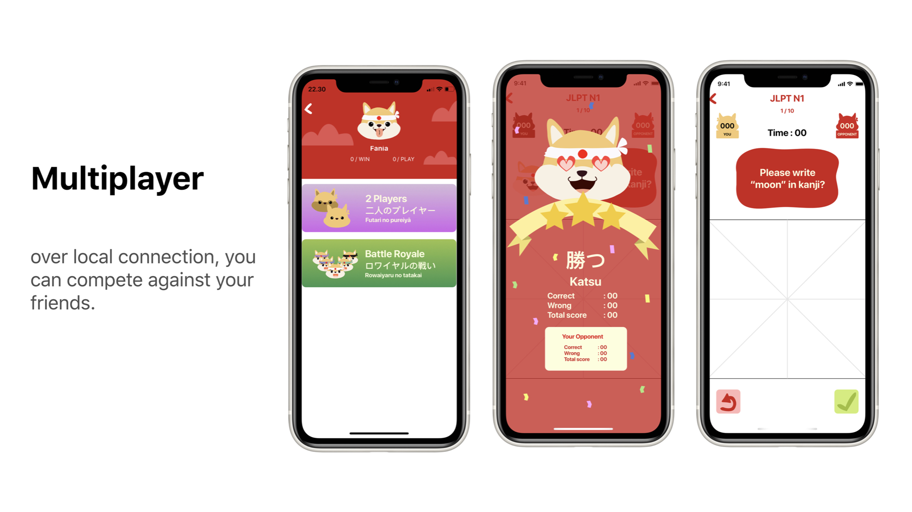

Hi Kanji is an an app that helps you to learn Kanji, write and memorise Kanji writings in a fun way by competing with your friends. 
I utilize Apple's Machine Learning framework, called `CoreML` to detect/recognize user's stroke on canvas. I have trained a lot of common Kanji characters to be a machine learning models.

