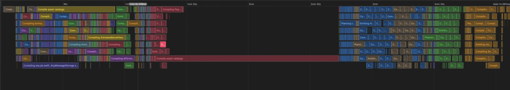
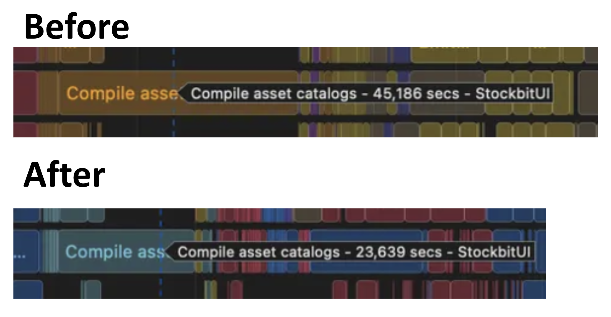
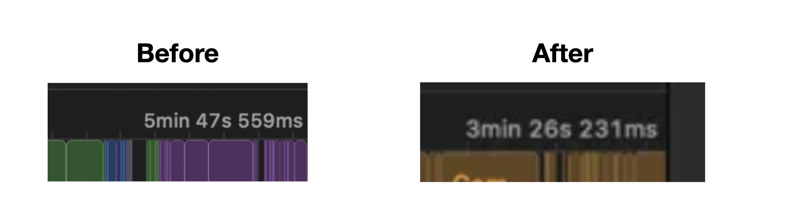

## Background

We notice that there's a bottle-neck in compiling our Stockbit apps. That is `Compiling Assets Catalog` phase. When this phase is being executed, no other process happens. The whole system is only waiting that assets compiling. It can waste the time, since actually anything can be compiled parallelly, but not for this assets catalog.

## Execution

We try to spread the assets to the corresponding module, instead of placing it on low-level module. The only left assets which is placed on low-level modules are the assets which are used generally from all of higher module. We also re-organize the assets architecture for the shared assets. The idea is creating a new modules on the lower level which only contains the image assets.

This execution results in compressing the `compile asset catalog` time by `22 seconds`, 50% from formerly `45 seconds`.

Another things we do are:

* Unused 3rd Party Lib Removal
* Modularization Revisit

## Final Result

As the final result from solving compiling assets catalog bottle-neck, removal of unused 3rd party library, and modularization revisit, we can cut the total build time almost 50%. From almost `6 minutes` to be only `3 minutes 26 seconds`.

