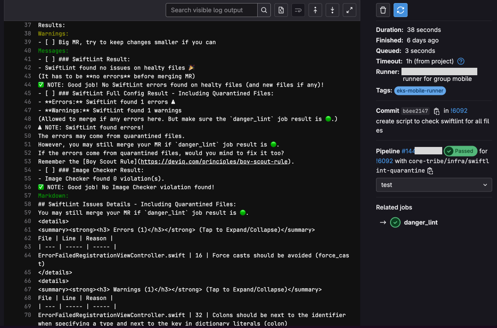

<!-- The original page for this item was empty; this reuses the item text from the Portfolio page. -->

Since we can run `Swift` in Linux by using `Swift Toolchain`, I enabled `danger-swiftlint` to run on a CI Linux Runner.

<figure class="narrow" style="--w: 500px">

</figure>

The process was significantly faster on Linux, completing in just `38 seconds`, compared to over `3 minutes` on Xcode Cloud CI.
